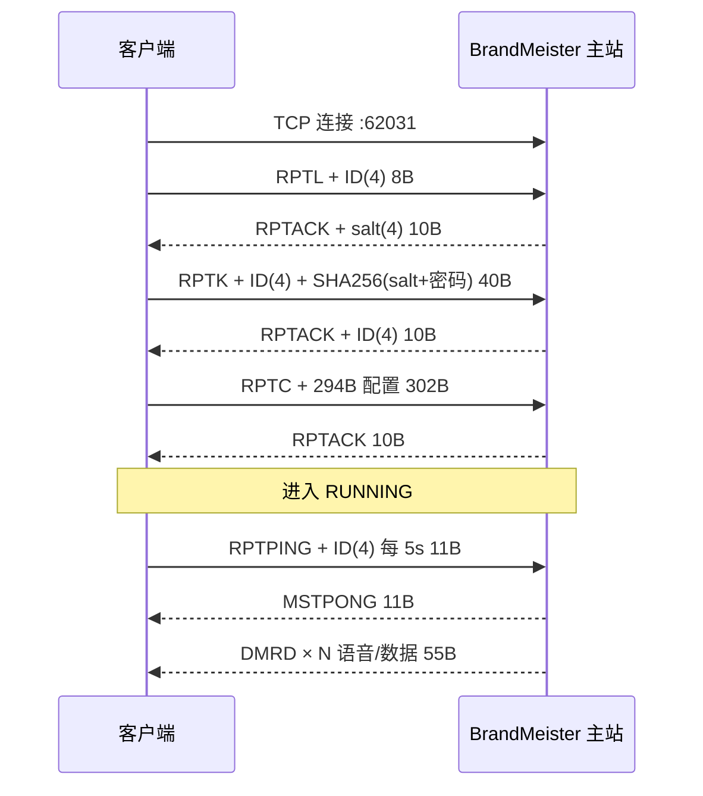

# Pi-Star × BrandMeister（Swift 实现）

把 Pi-Star 里「连上 BrandMeister，收听通话组」这条链路用 Swift 重写成一个可运行的工程：
Homebrew（HBP/MMDVM）协议客户端 + DMRD 解析 + 通话生命周期还原 + SwiftUI 界面 + 命令行工具。

```
BrandMeister 主站  ⇄  TCP 62031  ⇄  HomebrewClient  →  CallTracker  →  声码器  →  音频/界面
                                   （登录/鉴权/保活）   （还原一通电话）  （AMBE+2）
```

## 与 Pi-Star 的对应关系

| Pi-Star（C++） | 本工程（Swift） | 作用 |
| --- | --- | --- |
| `MMDVMHost/CDMRNetwork` + `DMRGateway/CDMRNetwork` | `HomebrewClient` | TCP 连接、RPTL/RPTK/RPTC 握手、5s 心跳、60s 超时、重连 |
| `CDMRData` / `DMRDefines.h` | `DMRDataPacket`、`DMRDataType` | 55 字节 DMRD 包的读/写、时隙与呼叫类型位 |
| `CDMRDMRSlot` 的呼叫处理 | `CallTracker`、`CallSession` | 从 LC header 到 terminator 还原一通通话 |
| 环形缓冲区 + 收包线程 | `HomebrewFramer` | TCP 粘包/半包切分（DMRGateway 用 UDP，没有这一步） |
| `CSHA256` | `SHA256Auth`（CryptoKit） | `SHA256(salt ‖ password)` |
| `MMDVMHost` 的 AMBE 解码 | `VoiceDecoder` 协议 | 可插拔，默认不发声（见「语音解码」） |

## 登录时序



- `MSTNAK` → 登录/鉴权阶段视为致命错误（ID 或密码错误），重新走握手；
- `MSTCL` → 主站断开，立即重连；
- 60 秒收不到任何主站数据 → 判定掉线，按 1/2/4/8…30 秒退避重连。

## DMRD 包（55 字节）

| 偏移 | 长度 | 字段 |
| --- | --- | --- |
| 0–3 | 4 | `"DMRD"` |
| 4 | 1 | 序号 |
| 5–7 | 3 | 源 ID（24 位大端） |
| 8–10 | 3 | 目的 ID（24 位，组呼为通话组号） |
| 11–14 | 4 | 中继 ID |
| 15 | 1 | 标志位：bit7 时隙 / bit6 个呼 / bit5 数据同步 / bit4 语音同步 / bit0–3 帧号 N 或数据类型 |
| 16–19 | 4 | Stream ID |
| 20–52 | 33 | DMR 负载（6B 同步/时隙类型 + 3×9B AMBE 块） |
| 53 | 1 | BER |
| 54 | 1 | RSSI |

## 目录

```
Package.swift                     SwiftPM 清单（tools 6.0，Xcode 27 可直接打开）
project.yml                       XcodeGen 描述 → 原生 .xcodeproj
Config/BrandMeister.entitlements  App Sandbox + 出站网络权限
Scripts/generate-xcodeproj.sh     一键生成 Xcode 工程
Sources/BrandMeisterKit/
  Protocol/   HBP 常量与状态、DMRD 包、RPTC 配置、SHA256、TCP 切包
  Client/     HomebrewClient（连接/握手/保活/重连）
  Call/       CallSession、CallTracker（通话生命周期）
  Media/      DMRVoicePayload（33B → 3 个 AMBE 块）、VoiceDecoder、PCMAudioPlayer
  BrandMeisterSession.swift   门面：把上面几层串起来
Sources/bmwatch/              命令行监听工具
Sources/BrandMeisterApp/      SwiftUI macOS App
Tests/BrandMeisterKitTests/   协议与通话状态的单元测试
```

## 在 Xcode 27 里编译

需要 macOS 15+ / Xcode 27（Swift 6 编译器、macOS 27 SDK）。两条路，选一条：

**A. 直接打开 SwiftPM 包（零配置，建议先跑通）**

```bash
open Package.swift        # 或在 Xcode 27 里 File > Open 选 Package.swift
```

选 `BrandMeisterApp` scheme → Run。可以打断点、看变量、跑 Instruments。
局限：产物是命令行可执行文件，没有 .app 包、图标、签名、Sandbox。

**B. 生成原生 .app 工程（要签名 / 打包 / 上架时用）**

```bash
brew install xcodegen
bash Scripts/generate-xcodeproj.sh
open BrandMeister.xcodeproj
```

`project.yml` 会生成三个 target：

| target | 类型 | 说明 |
| --- | --- | --- |
| `BrandMeister` | macOS App | SwiftUI 界面，已开 App Sandbox + `com.apple.security.network.client` |
| `BrandMeisterKit` | 静态库 | 协议栈，被 App 与 CLI 直接链入（免去 embed / rpath） |
| `bmwatch` | Command Line Tool | 命令行监听 |

**构建配置（与 Xcode 27 相关的几项）**

| 设置 | 值 | 原因 |
| --- | --- | --- |
| 编译器 / SDK | Swift 6 / macOS 27 SDK | Xcode 27 默认工具链 |
| `SWIFT_VERSION` | `5.0` | 语言模式固定 v5，见下方说明 |
| `SWIFT_STRICT_CONCURRENCY` | `minimal` | 与 v5 语言模式匹配 |
| `SWIFT_DEFAULT_ACTOR_ISOLATION` | `nonisolated` | Xcode 26 起新建 App 默认把 target 推断成 MainActor，会把网络收发钉在主线程 |
| `MACOSX_DEPLOYMENT_TARGET` | `15.0` | 与 `Package.swift` 的 `.macOS(.v15)` 对齐 |

> **关于语言模式**：本工程的网络层沿用 Pi-Star 的「一条串行队列 + 回调」模型，
> 在 Swift 6 严格并发下会被判为违反 `Sendable`。所以 `Package.swift` 里
> `.swiftLanguageMode(.v5)`、`project.yml` 里 `SWIFT_VERSION = 5.0` 显式固定为 v5 ——
> 用 Xcode 27 的编译器编译，但不启用 v6 的隔离检查。
> 想切 v6：把这两处改成 `6.0`，再把 `HomebrewClient`、`CallTracker`、`PCMAudioPlayer`
> 改成 `actor`（或标 `@unchecked Sendable` 并把回调标 `@Sendable`）。

## 命令行

```bash
swift build
swift test

# 监听（把 ID 和密码换成你自己的）
swift run bmwatch --id 4601234 --password '你的Hotspot密码' --tg 91,460 --verbose
```

> `bmwatch --audio` 只有接上声码器后才会出声，否则只统计 AMBE 块数量。

## BrandMeister 侧必须先做的事

1. **DMR ID**：用你自己的 ID 登录（热点复用个人 ID 即可）。
2. **Hotspot 密码**：BrandMeister 自助页面 → *Hotspot Security* 里设置，不是网页登录密码。
3. **静态通话组（关键）**：主站只把你在自助页面配置的 Static Talkgroup（TS1/TS2）推给你。
   没有配的 TG，客户端即使连上也收不到语音——这与 Pi-Star 的行为完全一致。
4. 出站放通 **TCP 62031**。

## 语音解码（让它出声）

DMR 用 AMBE+2（DVSI 专利），没有公开的纯 Swift 实现，工程默认用 `NullVoiceDecoder` 只统计不发声。
要真的听到声音，按下面接一个 mbelib：

1. 把 [mbelib](https://github.com/szechyjs/mbelib) 源码放到 `Vendor/mbelib/`；
2. 在 `Package.swift` 加一个 C 目标，并提供两个 C 函数：

```c
// mbelib_shim.c —— 一个 72bit AMBE 块 → 160 个 8kHz 采样
int mbe_decode_dmr_block(const unsigned char *block72, short *pcm160);
```

3. Swift 侧实现解码器：

```swift
final class MbelibDecoder: VoiceDecoder {
    let sampleRate: Double = 8000
    func decode(block: [UInt8]) -> [Int16]? {
        var pcm = [Int16](repeating: 0, count: 160)
        let ok = block.withUnsafeBufferPointer { src in
            pcm.withUnsafeMutableBufferPointer { dst in
                mbe_decode_dmr_block(src.baseAddress!, dst.baseAddress!)
            }
        }
        return ok == 0 ? pcm : nil
    }
    func reset() {}
}
```

4. 用 `BrandMeisterSession.Options(..., audioEnabled: true, decoder: MbelibDecoder())` 启动即可。

`DMRVoicePayload` 已经按「6 字节同步/时隙类型 + 3×9 字节 AMBE 块」切开，
mbelib 里的 FEC（Golay/汉明）与 AMBE 参数解码在 shim 里完成。

## 已知限制

- **只收不发**：发送需要 AMBE **编码器**（DVSI 芯片或授权算法），本工程不包含；
  `DMRDataPacket.encoded()` 保留了写包能力，便于以后接编码器。
- **不支持 Trunking（DTC）**：只实现标准 55 字节 DMRD，未实现 71 字节带 UUID 的变体。
- 通话组过滤在客户端完成，主站仍会把已订阅 TG 的流量全部推过来。
- 语音帧拆块按 ETSI/MMDVM 的 6+27 布局实现；不同主站若做私有重排需自行调整
  `DMRVoicePayload.headerLength`。
